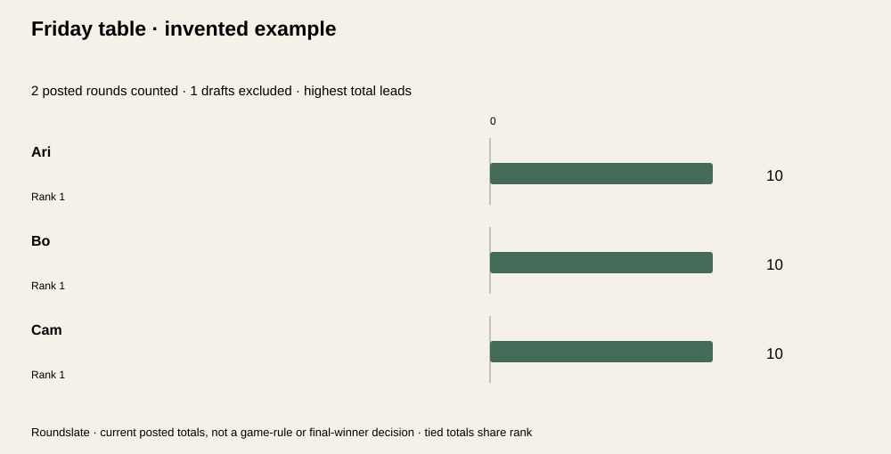

# Roundslate

**Every round has a story. Keep the numbers straight.**

[Open Roundslate](https://roundslate.vercel.app)

A local score ledger for casual card and board games. Record round point changes, post complete rounds, and keep unfinished entries out of the standings.



*Generated SVG from the invented example, not an editor screenshot.*

## Features

- **2–8 players** and up to **40 rounds** in one game.
- Positive, negative and zero integer scores; blanks remain explicitly unset.
- Saved draft rounds that do not affect standings.
- Post only when every player has a score; reopen before correcting or deleting a posted round.
- Highest-total or lowest-total standings with tied competition ranks.
- 25-action undo / redo, local browser saving and portable JSON backups.
- Full HTML/CSV ledgers, derived count receipts and an SVG standings snapshot.

No account, analytics, application uploads, paid APIs or runtime dependencies. Roundslate adds entered scores; it does not apply game-specific rules.

## Run locally

Use Node.js 22 or 24 and npm:

```sh
npm ci --ignore-scripts --no-audit --no-fund
npm test
npm run example
npm run build
npm run dev
```

Open **http://127.0.0.1:4201**. The development server binds only to loopback and serves allowlisted built assets. Rebuild after source changes.

jsdom is a development-only dependency for simulated DOM checks. The static build uses Node built-ins.

## Play with a clear ledger

1. Save the game title, score direction and player names, one name per line.
2. Add a draft round. Enter each player’s **point change for that round**, not their running total.
3. Select **Save draft scores**. This saves the entered values while keeping the round out of standings.
4. Once every player’s score is explicitly entered, select **Post saved round**.
5. To correct a posted round, select **Reopen** in the ledger. It immediately leaves standings. Edit, save, then post again.
6. Download project JSON periodically to keep a portable backup.

Blank is not zero. Enter `0` when the score is zero. A draft can contain both entered scores and blanks; neither contributes to totals until the round is posted.

Unsaved **editor inputs** are different from saved **draft rounds**. Save or revert editor inputs before switching rounds, posting, loading a game or downloading. The previous saved ledger remains intact if an edit is invalid.

### Standings and ties

Only posted rounds contribute to player totals. With no posted rounds, players have no rank or leader.

Ties share competition rank: scores 10, 10, 5 produce ranks **1, 1, 3** when highest total leads. Choose lowest total when your own game requires it. Tied players retain roster order; no tiebreaker or final winner is inferred.

Rounds can be posted independently; there is no requirement to finish them in order. The posted-round count above the standings shows their basis.

### Roster and corrections

Player count locks after any round exists. Start a new game to use another roster, or remove all rounds first. Same-count renames preserve player IDs and score columns in their existing order. **Renaming a column does not transfer scores to another person.**

A posted round is read-only until reopened. Reopening preserves its scores and notes but removes it from totals. Deleting requires draft status; Undo can restore the round during the current session. A round label can repeat; stable round IDs distinguish rows.

## Saving and recovery

One game is stored under this website’s origin, in this browser on this device. There is no game library, account, cloud backup or cross-device sync.

- Saved setup changes, round edits and posting/reopening actions write to local storage when available.
- **Unsaved editor inputs and undo history are not persisted.**
- Storage denial or quota errors leave the current session usable in memory, with a visible warning. Download JSON or use **Keep this tab / retry saving** once storage access works.
- A changed browser copy triggers review. Export this tab first, then choose **Load browser copy** or **Keep this tab**.
- Keeping the tab explicitly replaces the stored copy. These checks are **best effort, not an atomic cross-tab lock**; near-simultaneous writes can still race. Use one editing tab.
- Invalid stored projects are preserved until you explicitly replace them or open a valid backup.
- Opening project JSON replaces this tab and its browser copy. The previous game remains in the session’s undo history.

Browser data can be cleared or lost. Local saving is not a backup.

## Export the whole record

| File | Includes |
| --- | --- |
| Project JSON | All editable game settings, IDs, names, round states, scores and notes |
| Count receipt JSON | Entire project plus posted-only standings, leaders and per-round completeness |
| Full ledger HTML | Every round, including incomplete drafts, plus posted-only standings and notes |
| Scores CSV | All round rows, states, notes and score cells, with a posted-only totals row |
| Standings SVG | Current posted totals and ranks; draft scores and full notes are in HTML / JSON |

In CSV, an empty score cell means unset; numeric zero remains `0`. Round labels/notes beginning with possible spreadsheet formula prefixes receive an apostrophe guard. Quoting and this guard do not guarantee safe behavior in every spreadsheet application. JSON and HTML retain literal labels/notes without that CSV-specific change.

Actual invented files: [project](examples/table-project.json), [receipt](examples/table-receipt.json), [ledger](examples/table-ledger.html), [CSV](examples/table-scores.csv), [SVG](examples/table-standings.svg). The example has two posted rounds and one incomplete draft. All three posted totals are 10; a 20-point draft entry is excluded.

Open HTML to print or save as PDF. Only project JSON is an editable import format.

## Limits and privacy

Scores are whole numbers from **−999,999 to 999,999** per player per round. Fractions, decimal input and exponent input are rejected rather than rounded. Maximum 40-round totals remain exact integers.

Titles allow 80 UTF-16 units, player names 32, round labels 64, round notes 200 and game notes 1,000. Names must be nonblank and distinct ignoring case. Imports accept this exact project schema, up to 150,000 characters / 600,000 UTF-8 bytes, and reject invalid shapes, missing player score fields and incomplete posted rounds.

Entered content is not uploaded by the application. The host receives ordinary asset requests. Browser storage and exported files can contain names and notes, so keep and share them deliberately.

There is no game-rule engine, automatic finalization, per-round roster change, decimal scoring, tournament administration, score verification, fairness guarantee or authentication. Users must decide how their game handles penalties, absences and tied results.

## Verification

`npm test` verifies blank-versus-zero parsing, negative totals, both ranking directions, tied ranks, guarded posting/reopening/deletion, roster identity, 25-action history, 60 independently recounted ledgers, maximum 40-round/8-player totals, complete escaped exports, CSV blank/zero and guard behavior, signed SVG bounds, denied/quota/invalid browser storage, actual scorekeeper event handlers, full download Blob contents and file-read races.

CI runs Node 22/24 on Windows and Linux. UI checks use **jsdom, a simulated DOM**. Native browser interaction, actual browser cross-tab behavior, responsive visual rendering, assistive technology, native downloads, physical print output and a real editor screenshot have not been verified. The image above is an actual generated export.

## Deploy on Vercel

Import the repository. Choose framework **Other**, Node **24.x**, build command `npm run build`, output directory `dist`, and an empty install command. No environment variables or paid services are required. `vercel.json` supplies static build settings and security headers.

## Code and format

`src/model.mjs` validates the ledger and derives posted standings; `edit.mjs` enforces transitions; `storage.mjs` manages browser-copy review; `export.mjs` generates complete files; `app.mjs` runs the workspace; `handoff.mjs` guards local file reads and URLs.

[File-format notes](docs/file-format.md). MIT licensed.
